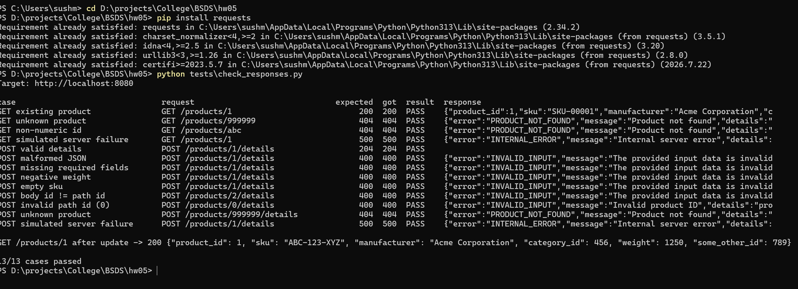
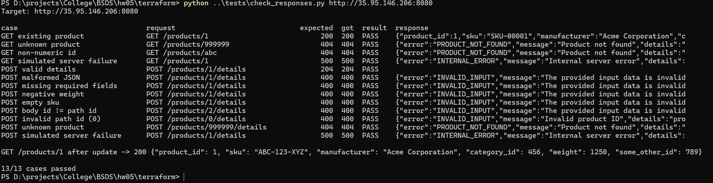
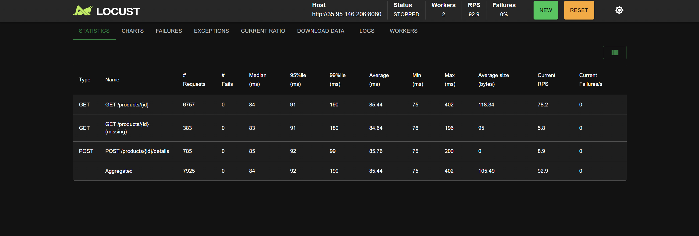
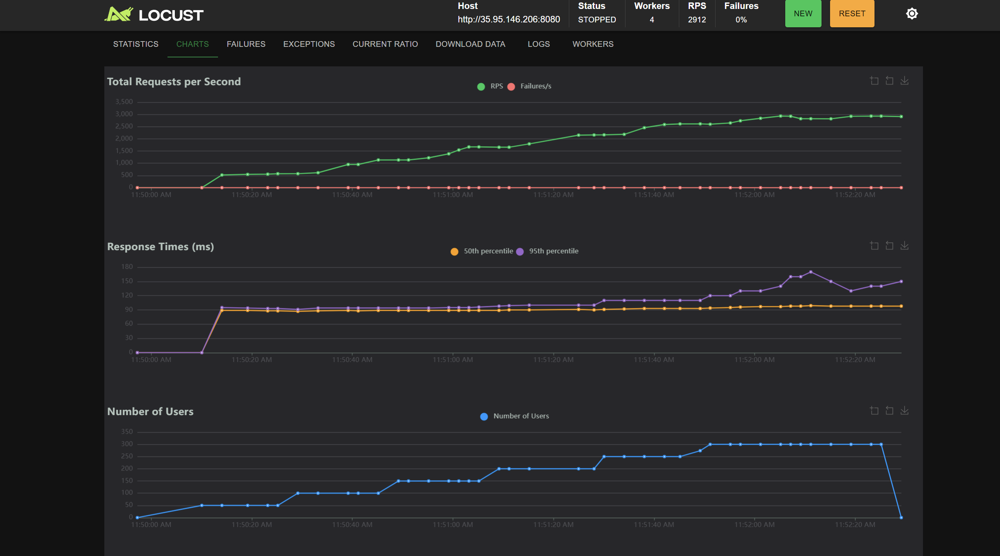
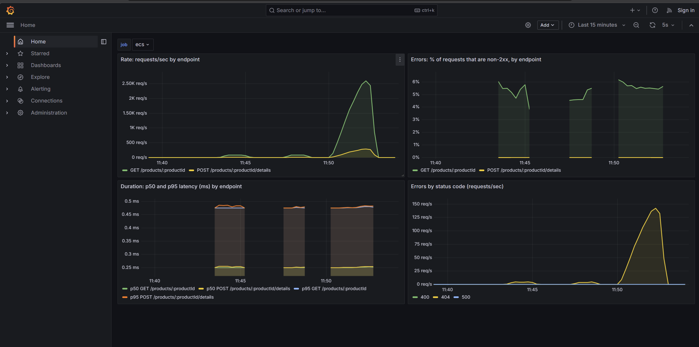

# Product API on ECS (CS6650 HW5)

A Go/Gin implementation of the **Products** part of `api.yaml`, deployed to AWS ECS Fargate with Terraform, load tested with Locust, and instrumented with Prometheus/Grafana and structured logs.

## Repository layout
| Path | What it is |
|---|---|
| `src/product-service.go` | The Product API server (Gin, in-memory store, validation, `/metrics`, JSON request logs) |
| `src/go.mod`, `src/go.sum` | Go module and dependencies |
| `src/Dockerfile` | Multi-stage build of the server image (used by Terraform) |
| `terraform/` | Infrastructure as code (forked starter): `provider.tf`, `variables.tf`, `main.tf`, `outputs.tf`, and modules `network`, `ecr`, `logging`, `ecs` |
| `tests/check_responses.py` | Sends a request for every documented response code and checks it |
| `loadtest/` | Locust files (HttpUser, FastHttpUser, stress test) and docker-compose for master/workers |
| `observability/` | docker-compose with the API + Prometheus + Grafana (pre-built RED dashboard) |
| `screenshots/` | Test, load-test and dashboard screenshots |

---

## 1. The API

| Endpoint | Success | Errors |
|---|---|---|
| `GET /products/{productId}` | `200` Product JSON | `404` not found, `500` server error |
| `POST /products/{productId}/details` | `204` no body | `400` invalid input, `404` not found, `500` server error |

Error responses follow the `Error` schema: `{"error": "...", "message": "...", "details": "..."}`.

**Behaviour notes**
- **Seeded catalog:** `api.yaml` has no "create product" endpoint, and `POST /details` must return `404` for unknown products, so the server starts with products **1..1000** (change with env `SEED_PRODUCTS`). `POST /details` adds/updates details for an existing product.
- **Validation (`400`)**: path `productId` must be an integer 1..2147483647; body must be one JSON object with all six required fields; `sku` 1-100 chars, `manufacturer` 1-200 chars, `product_id`/`category_id`/`some_other_id` >= 1, `weight` >= 0, all integers within int32; body `product_id` must equal the path `productId`.
- **`GET` with a non-numeric id** returns `404`, because `api.yaml` lists only 200/404/500 for that endpoint.
- **Triggering `500`:** send header `X-Simulate-Error: true`. The handler panics and the recovery middleware returns a `500` Error response (this exercises the real panic-recovery path).
- **Extras:** `GET /health` (liveness) and `GET /metrics` (Prometheus).
- **Data structure:** `map[int32]Product` guarded by a `sync.RWMutex`: O(1) lookups, many concurrent readers, exclusive writers. `UpdateIfExists` checks and writes under one lock so the check-then-write is atomic.

---

## 2. Run locally
```bash
cd src
go mod tidy
go run .                                   # http://localhost:8080
```
With Docker:
```bash
cd src
docker build -t product-service .
docker run --rm -p 8080:8080 product-service
```

## 3. Examples for every response code
Run all cases at once (works for local or ECS):
```bash
pip install requests
python tests/check_responses.py http://localhost:8080
python tests/check_responses.py http://<ECS-PUBLIC-IP>:8080
```


Individual `curl` examples (bash; on Windows use `curl.exe` and Git Bash, or the script above):
```bash
# 200 OK: product exists
curl -i http://localhost:8080/products/1

# 404 Not Found: product does not exist
curl -i http://localhost:8080/products/999999

# 500 Internal Server Error: simulated failure
curl -i -H "X-Simulate-Error: true" http://localhost:8080/products/1

# 204 No Content: details added
curl -i -X POST http://localhost:8080/products/1/details -H "Content-Type: application/json" \
  -d '{"product_id":1,"sku":"ABC-123-XYZ","manufacturer":"Acme Corporation","category_id":456,"weight":1250,"some_other_id":789}'

# 400 Bad Request: missing required fields
curl -i -X POST http://localhost:8080/products/1/details -H "Content-Type: application/json" \
  -d '{"product_id":1}'

# 400 Bad Request: body product_id does not match the path
curl -i -X POST http://localhost:8080/products/2/details -H "Content-Type: application/json" \
  -d '{"product_id":1,"sku":"ABC","manufacturer":"Acme","category_id":1,"weight":10,"some_other_id":1}'

# 404 Not Found: adding details to a product that does not exist
curl -i -X POST http://localhost:8080/products/999999/details -H "Content-Type: application/json" \
  -d '{"product_id":999999,"sku":"ABC","manufacturer":"Acme","category_id":1,"weight":10,"some_other_id":1}'

# 500 Internal Server Error: simulated failure
curl -i -X POST http://localhost:8080/products/1/details -H "X-Simulate-Error: true" -H "Content-Type: application/json" \
  -d '{"product_id":1,"sku":"ABC","manufacturer":"Acme","category_id":1,"weight":10,"some_other_id":1}'
```

---

## 4. Deploy to AWS with Terraform
**Prerequisites:** Terraform, AWS CLI, Docker Desktop (running), AWS Academy Learner Lab.

**1. Credentials.** Start the Learner Lab, open *AWS Details → AWS CLI*, and paste the block into `~/.aws/credentials` (or run `aws configure` and `aws configure set aws_session_token <TOKEN>`). Region: `us-west-2`. Check with:
```bash
aws sts get-caller-identity
```
**2. Deploy.** Terraform builds the image from `src/`, pushes it to ECR, and starts the ECS service:
```bash
cd terraform
terraform init
terraform apply -auto-approve
```
**3. Get the public IP** (from the `terraform` folder).

Bash:
```bash
aws ec2 describe-network-interfaces --network-interface-ids $(
  aws ecs describe-tasks --cluster $(terraform output -raw ecs_cluster_name) --tasks $(
    aws ecs list-tasks --cluster $(terraform output -raw ecs_cluster_name) \
      --service-name $(terraform output -raw ecs_service_name) --query 'taskArns[0]' --output text) \
  --query "tasks[0].attachments[0].details[?name=='networkInterfaceId'].value" --output text) \
  --query 'NetworkInterfaces[0].Association.PublicIp' --output text
```
PowerShell:
```powershell
$cluster = terraform output -raw ecs_cluster_name
$service = terraform output -raw ecs_service_name
$task = aws ecs list-tasks --cluster $cluster --service-name $service --query "taskArns[0]" --output text
$eni = aws ecs describe-tasks --cluster $cluster --tasks $task --query "tasks[0].attachments[0].details[?name=='networkInterfaceId'].value" --output text
aws ec2 describe-network-interfaces --network-interface-ids $eni --query "NetworkInterfaces[0].Association.PublicIp" --output text
```
**4. Send requests.**
```bash
curl http://<PUBLIC-IP>:8080/products/1
python tests/check_responses.py http://<PUBLIC-IP>:8080
```
**Logs on AWS:** the task sends stdout to CloudWatch Logs (log group `/ecs/product-api`):
```bash
aws logs tail /ecs/product-api --follow
```
**Redeploying after a code change:** Terraform does not rebuild the image when only the code changes, and ECS keeps running the old `:latest`. Force both:
```bash
terraform apply -auto-approve -replace=docker_image.app -replace=docker_registry_image.app
aws ecs update-service --cluster $(terraform output -raw ecs_cluster_name) --service $(terraform output -raw ecs_service_name) --force-new-deployment
```
**5. Clean up.**
```bash
terraform destroy -auto-approve
```

---

## 5. Load testing (Locust)
See `loadtest/`. Request mix: **85% GET existing, 5% GET missing (expected 404), 10% POST details**.
```powershell
cd loadtest
$env:TARGET_HOST="http://<PUBLIC-IP>:8080"
$env:USER_CLASSES="ProductUser";     docker compose up --scale worker=2   # HttpUser
$env:USER_CLASSES="FastProductUser"; docker compose up --scale worker=2   # FastHttpUser
$env:LOCUSTFILE="locustfile_stress.py"; $env:USER_CLASSES="StressUser"; docker compose up --scale worker=4   # stress
```
Web UI: http://localhost:8089

_Results and screenshots: see section 7._

## 6. Observability (Prometheus + Grafana + logs)
```bash
cd observability
docker compose up --build
```
- Grafana: http://localhost:3000 → dashboard **Product API - RED** (rate, error %, p50/p95 latency, errors by status)
- Prometheus: http://localhost:9090
- Request logs (one JSON line per request): `docker compose logs app`

Example log line:
```json
{"time":"...","level":"INFO","msg":"request","method":"GET","path":"/products/42","route":"/products/:productId","status":200,"duration_ms":0.087,"client_ip":"172.18.0.4"}
```

---

## 7. Results
**Deployed API, all response codes:** 

**HttpUser vs FastHttpUser** (100 users, ramp 20/s, 85% GET / 5% GET-missing / 10% POST):
| Client | RPS | Median | p95 | Failures |
|---|---|---|---|---|
| HttpUser | 92.9 | 84 ms | 92 ms | 0 |
| FastHttpUser | 93.2 | 83 ms | 93 ms | 0 |

 

**No real difference.** Locust is closed-loop: 100 users / (~1 s think time + ~0.085 s response) is about 92 RPS, so the users cap the rate, not the client. The ~84 ms latency is almost all network round trip from my laptop to us-west-2, so FastHttpUser's lower client overhead is invisible. It only matters when the load generator's CPU is the bottleneck.

**Stress test** (+50 users every 20 s up to 300, no think time): 

**Most common operation:** reads (GET) dominate a store, so the in-memory map uses a `sync.RWMutex`, which lets many GETs proceed in parallel while POSTs take the exclusive lock.

**Grafana, idle vs loaded:** 
Request log excerpt: [request-logs.txt](screenshots/request-logs.txt)

**Dashboard vs logs:** I use the dashboard to see *that* something is wrong right now and when it started (rate drops, error % rises, p95 climbs). I use the logs afterwards to see *which* requests failed and why, since every line records the endpoint, status, and duration.